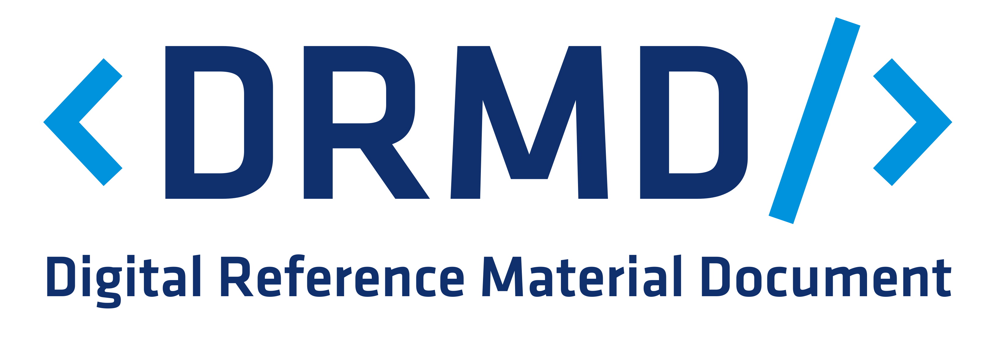

<p align="center">
  <a href="https://bamresearch.github.io/drmd/">
    <picture>
      <source media="(prefers-color-scheme: dark)" srcset="assets/drmd-logo-on-white.png">
      
    </picture>
  </a>
</p>

<h1 align="center">DRMD (Digital Reference Material Document) Schema</h1>

<p align="center">
  <a href="https://github.com/BAMresearch/drmd-schema/actions/workflows/validate.yml"></a>
  <a href="CHANGELOG.md"></a>
  <a href="COPYING.LESSER"></a>
  <a href="#how-each-iso-334012024-table-1-requirement-is-met"></a>
</p>

**Digital Reference Material Document (DRMD)**, an XML format for reference material
certificates and product information sheets, aligned with **ISO 33401:2024**, *Reference
materials: Contents of certificates, labels and accompanying documentation*.

This repository holds the XML Schema of the DRMD and its business rules (Schematron), version
**1.0.0**, published by the Bundesanstalt für Materialforschung und -prüfung (BAM). The DRMD
reuses the Digital Calibration Certificate (DCC) and the Digital System of Units (D-SI) of the
Physikalisch-Technische Bundesanstalt (PTB) wherever the content is the same.

| Part of the DRMD project | Where |
|---|---|
| Project website | <https://bamresearch.github.io/drmd/> |
| Schema and business rules | this repository |
| Guidance document for producers, software developers, laboratories and auditors | <https://bamresearch.github.io/drmd-guidance/> |
| DRMD AI Generator, which converts PDF documents into DRMDs | <https://bamresearch.github.io/drmd-generator/> |

| Path | Content |
|---|---|
| `drmd.xsd` | The schema: structure, types, cardinalities |
| `drmd-business-rules.sch` | Schematron: the ISO 33401:2024 requirements that XSD cannot express |
| `catalog.xml` | XML catalog, so validation runs offline and reproducibly |
| `supporting/` | Vendored third-party schemas (DCC, D-SI, QUDT, XML Signature), with their licences |
| `examples/` | Two worked, fully compliant instances |
| `tests/` | Proof that every rule fires when it should, a second Schematron implementation that must agree, a check of the verdicts and exit codes of `validate.py`, a second XSD check with Xerces, and a check of the conversion from release v0.3.0 |
| `tools/` | `validate.py`, `vendor_supporting_schemas.py`, and the converter for documents of release v0.3.0 (`convert-v0.3.0-to-v1.0.0.xsl`, `convert_v0_3_0.py`) |
| `CHANGELOG.md`, `CONTRIBUTING.md`, `SECURITY.md`, `CODE_OF_CONDUCT.md` | Versions, how to take part, how to report a security problem |
| `COPYING.LESSER`, `COPYING`, `NOTICE` | The licence (GNU LGPL v3 and the GNU GPL v3 it builds on) and the licences of all files |
| `assets/`, `LOGO_POLICY.md` | The DRMD logo and the terms for using it; the logo is not covered by the LGPL |
| `CITATION.cff` | How to cite this work |

---

## Quick start

```bash
pip install lxml

# Validate the worked examples (XSD + Schematron in one pass)
python tools/validate.py examples/*.xml

# Validate your own document
python tools/validate.py my-certificate.xml

# Check that the vendored dependencies are complete and the schema compiles offline
python tools/vendor_supporting_schemas.py --check

# Prove every business rule still fires, that a second Schematron implementation agrees,
# and that validate.py gives the documented verdicts and exit codes
python tests/test_rules.py
python tests/cross_check_xslt.py
python tests/test_validate.py

# Convert a document of the earlier release v0.3.0, and check the conversion
python tools/convert_v0_3_0.py old.xml converted.xml --document-version 1 --validate
python tests/test_convert.py
```

---

## Two document types

The type is set by `titleOfTheDocument`, and it changes which rules apply.

| Type | XML value | What it is |
|---|---|---|
| Reference Material Certificate | `referenceMaterialCertificate` | Accompanies a **certified** reference material (CRM). At least one property value is certified, every certified value carries its measurement uncertainty, and the document states metrological traceability. |
| Product Information Sheet | `productInformationSheet` | Accompanies **any other** reference material (ISO 33401:2024, 3.3). Uncertainty and traceability are permitted but not required. |

**What distinguishes the two.** A certified reference material has been characterised by a
metrologically valid procedure, and its certificate gives the value of each certified property,
the uncertainty of that value and its metrological traceability (ISO 33401:2024, 3.2). A product
information sheet accompanies a reference material that has not been certified in this way (3.3).
Its property values can be measured, assigned or nominal values, and they can come with an
uncertainty and a statement of traceability, which is good practice. What a product information
sheet may never do is mark a properties block as certified (`isCertified="true"` or `"1"`),
because that would present the material as certified when it is not.

---

## Why two validation files

`drmd.xsd` describes the structure that both document types share. It can say *"validity is
required"*. It cannot say *"if this is a certificate, then metrological traceability is
required"*. XSD 1.0 has no way to make a requirement depend on the value of another element.

`drmd-business-rules.sch` makes exactly those conditional statements. It reads
`titleOfTheDocument` and applies the ISO 33401:2024 requirements for that document type.

**Both must pass.** An XSD-valid document can still be non-compliant with ISO 33401:2024, and
running the XSD alone gives a false sense of correctness.

```
your-document.xml
       │
       ├──► drmd.xsd                  structure, names, data types, cardinalities
       │
       └──► drmd-business-rules.sch   ISO 33401:2024 requirements, per document type
                                      + severity: error / conditional-error / warning
```

---

## Severity: the four-tier model

Each Schematron rule carries a `role` that follows the ISO 33401:2024 requirement level of what it
checks. One rule combines two levels: DRMD-014 checks the measurement procedures that 5.2.14 makes
mandatory whenever applicable and 5.4.2 recommends, and it uses the stricter level.

| Tier | `role` | ISO level | Meaning |
|---|---|---|---|
| Hard error | `error` | Mandatory | The document is non-compliant. The element is required without exception. |
| Conditional error | `conditional-error` | Mandatory whenever applicable | Required **if it applies to this material**. Where it genuinely does not apply, absence is acceptable, and the producer, not the validator, makes that judgement. `tools/validate.py` reports such a document as TO CONFIRM. |
| Warning | `warning` | Recommended | The document is compliant. The element is recommended and improves usability. |
| No rule | none | Optional | Accepted when present, never flagged when absent. |

`conditional-error` is a custom role. The Schematron specification allows any string in `@role`,
and standard processors report it as an ordinary failed assertion in their SVRL output. A
validation pipeline should read the `role` attribute and classify accordingly. A tool that
treats every failed assertion as a hard error will wrongly reject documents where a conditional
requirement genuinely does not apply. `tools/validate.py` gives three verdicts: COMPLIANT, TO
CONFIRM (no error, but conditional findings that the producer must confirm do not apply) and NOT
COMPLIANT, with the exit codes 0, 3 and 1.

### What to do with a conditional error

It is a question, not a verdict: *does this apply to your material?*

* **Yes, it applies**: add the information. The document is not compliant without it.
* **No, it does not apply**: record why. For commutability, say so in the element: a statement
  reading "commutability has not been assessed for this material" is more useful, and more
  honest, than an absent element, and it clears the rule. A minimum sample size and measurement
  procedures are structured elements: do not invent values to clear the rule. Leave the element
  out, note in your quality records why it does not apply, because an auditor will ask, and
  accept the TO CONFIRM verdict.

---

## Document structure

```
digitalReferenceMaterialDocument              @schemaVersion required
│
├── administrativeData                                        [both]
│   ├── coreData
│   │   ├── titleOfTheDocument     5.2.2                      [both]
│   │   ├── uniqueIdentifier       identifies the DOCUMENT    [both]
│   │   ├── documentVersion        5.2.13                     [both]
│   │   ├── documentIdentifiers                               [optional]
│   │   └── validity               5.2.8                      [both]
│   ├── referenceMaterialProducer  5.2.5                      [both]
│   └── respPersons                5.3.5   name + function    [RMC required, PIS optional]
│
├── materials                                                 [both]
│   └── material  (repeatable)
│       ├── name                   5.2.4                      [both]
│       ├── description            5.3.2                      [RMC required, PIS recommended]
│       ├── materialClass                                     [optional, repeatable]
│       ├── minimumSampleSize      5.2.7                      [mandatory whenever applicable]
│       ├── itemQuantities                                    [optional]
│       └── materialIdentifiers    5.2.3   identifies the RM  [both]
│
├── propertiesList                                            [both]
│   └── properties  (repeatable)          @isCertified, true only in a certificate
│       ├── name                                              [both]
│       ├── description                                       [optional]
│       ├── procedures             5.2.14 / 5.4.2             [mandatory whenever applicable]
│       ├── results                5.2.15 / 5.3.3             [both]
│       │   └── result  (repeatable) → data → quantity | list/quantity
│       └── measurementMetaData                               [optional]
│
├── statements                                                [both]
│   ├── intendedUse                5.2.6                      [both]
│   ├── commutability              5.2.9                      [mandatory whenever applicable]
│   ├── storageInformation         5.2.10                     [both]
│   ├── instructionsForHandlingAndUse  5.2.11                 [both]
│   ├── metrologicalTraceability   5.3.4                      [RMC required, PIS optional]
│   ├── healthAndSafetyInformation 5.4.3                      [recommended]
│   ├── subcontractors             5.4.4                      [optional]
│   ├── legalNotice                5.4.6                      [optional]
│   ├── referenceToCertificationReport 5.4.7                  [optional]
│   └── statement  (repeatable catch-all)                     [optional]
│
├── comment                                                   [optional]
├── document        embedded files, e.g. the PDF rendition    [optional, repeatable]
└── ds:Signature    XMLDSig, repeatable                       [optional]
```

RMC: reference material certificate. PIS: product information sheet. "both": required in both
document types.

### Two identifiers that are easy to confuse

`coreData/uniqueIdentifier` identifies **the document**. `material/materialIdentifiers` carries
the unique identifier of **the reference material** required by ISO 33401:2024, 5.2.3, normally
a product code plus a batch or lot number.

They are not interchangeable, and using the document identifier for 5.2.3 is a real compliance
gap: one document can cover several materials, and one material is described by successive
document revisions. Rule DRMD-016 enforces the material identifier.

---

## How each ISO 33401:2024, Table 1 requirement is met

The table below cites the titles of the requirements of ISO 33401:2024, Table 1, their requirement
levels for the two document types and their subclause numbers, to show where each requirement is
checked. The text of the subclauses is not reproduced; the standard is available from ISO and from
national standards bodies.

| Requirement | Subclause | Product info sheet | RM certificate | Enforced by |
|---|---|---|---|---|
| Title of the document | 5.2.2 | Mandatory | Mandatory | XSD (`titleOfTheDocument`, enumerated) + DRMD-001 |
| Unique identifier of the RM | 5.2.3 | Mandatory | Mandatory | **DRMD-016** (`material/materialIdentifiers`) |
| Name of the RM | 5.2.4 | Mandatory | Mandatory | XSD + DRMD-002, DRMD-007 |
| Name and contact details of the RM producer | 5.2.5 | Mandatory | Mandatory | XSD + DRMD-010 |
| Intended use | 5.2.6 | Mandatory | Mandatory | XSD + DRMD-004 |
| Minimum sample size | 5.2.7 | Mandatory whenever applicable | Mandatory whenever applicable | DRMD-008 (conditional-error) |
| Period of validity | 5.2.8 | Mandatory | Mandatory | XSD + DRMD-012 |
| Commutability | 5.2.9 | Mandatory whenever applicable | Mandatory whenever applicable | DRMD-013 (conditional-error) |
| Storage information | 5.2.10 | Mandatory | Mandatory | XSD + DRMD-005 |
| Instructions for handling and use | 5.2.11 | Mandatory | Mandatory | XSD + DRMD-006 |
| Document components | 5.2.12 | Mandatory | Mandatory | Satisfied structurally, see the note below |
| Document version | 5.2.13 | Mandatory | Mandatory | XSD + **DRMD-011** |
| Measurement procedures for operationally defined measurands | 5.2.14 | Mandatory whenever applicable | Mandatory whenever applicable | DRMD-014 (conditional-error) |
| Property of interest | 5.2.15 | Mandatory | Mandatory | DRMD-003, DRMD-009, PIS-002 |
| **Description of the material** | **5.3.2** | Recommended | **Mandatory** | RMC-011 (error) / PIS-005 (warning) |
| **Property value and associated uncertainty** | **5.3.3** | Optional | **Mandatory** | RMC-002, RMC-003, RMC-006 … RMC-009 |
| **Metrological traceability** | **5.3.4** | Optional | **Mandatory** | RMC-001 |
| **Name and function of the RM producer's approving officer** | **5.3.5** | Optional | **Mandatory** | RMC-010 (name) + **RMC-012** (function) |
| Measurement procedures for non-operationally defined measurands | 5.4.2 | Recommended | Recommended | RMC-005 (warning); also covered by DRMD-014 |
| Health and safety information | 5.4.3 | Recommended | Recommended | DRMD-015 (warning) |
| Subcontractors | 5.4.4 | Optional | Optional | XSD element, no rule |
| Indicative values | 5.4.5 | Optional | Optional | A properties block with `isCertified` false or omitted |
| Legal notice | 5.4.6 | Optional | Optional | XSD element, no rule |
| Reference to a certification report | 5.4.7 | Optional | Optional | XSD element, no rule |

**Document components (5.2.12).** ISO 33401:2024 asks that every part of an RM document can be
identified as belonging to it and that its end can be recognised. A DRMD instance meets this by
being a single well-formed XML document with one root element: its start and end are explicit, and every
component is inside it by construction. `@schemaVersion` states which specification the components
follow, `documentVersion` which revision, and `uniqueIdentifier` binds them to one instance. No
Schematron rule is defined, because an assertion that always holds would only add noise.

**Clause 6, Labels.** ISO 33401:2024 Clause 6 governs the physical label on the container, not the
electronic document, so it is out of scope for the schema. It matters for producers all the same:
the label must allow the right RM document to be identified, which in practice means printing the
identifier that appears in `material/materialIdentifiers`. Keeping those values byte-identical is
what makes the link between the physical unit and the digital document work.

---

## Complete rule catalogue

### Shared rules (every DRMD document)

| Rule | Severity | ISO | What it checks |
|---|---|---|---|
| DRMD-001 | error | 5.2.2 | `titleOfTheDocument` is declared |
| DRMD-002 | error | 5.2.4 | At least one `material` entry exists |
| DRMD-003 | error | 5.2.15 | At least one `properties` block exists |
| DRMD-004 | error | 5.2.6 | `intendedUse` is present |
| DRMD-005 | error | 5.2.10 | `storageInformation` is present |
| DRMD-006 | error | 5.2.11 | `instructionsForHandlingAndUse` is present |
| DRMD-007 | error | 5.2.4 | Every material has a `name` |
| DRMD-008 | conditional-error | 5.2.7 | `minimumSampleSize` is present where applicable |
| DRMD-009 | error | 5.2.15 | Every `properties` block has at least one `result` |
| DRMD-010 | error | 5.2.5 | `referenceMaterialProducer` is identified |
| DRMD-011 | error | 5.2.13 | `documentVersion` is stated |
| DRMD-012 | error | 5.2.8 | `validity` is specified |
| DRMD-013 | conditional-error | 5.2.9 | `commutability` is stated where applicable |
| DRMD-014 | conditional-error | 5.2.14, 5.4.2 | `procedures` are documented where applicable |
| DRMD-015 | warning | 5.4.3 | `healthAndSafetyInformation` is included |
| DRMD-016 | error | 5.2.3 | Every material carries a `materialIdentifier` |

### Certificate-only rules

| Rule | Severity | ISO | What it checks |
|---|---|---|---|
| RMC-001 | error | 5.3.4 | `metrologicalTraceability` is present |
| RMC-002 | error | 5.3.3 | At least one `properties` block has `isCertified="true"` |
| RMC-003 | error | 5.3.3 | Property values exist |
| RMC-005 | warning | 5.4.2 | At least one certified block documents its `procedures` |
| RMC-006 | error | 5.3.3 | A certified single `si:real`, `si:complex` or `si:constant` carries uncertainty |
| RMC-007 | error | 5.3.3 | A certified `si:real`, `si:complex` or `si:constant` inside a list carries uncertainty |
| RMC-008 | error | 5.3.3 | A certified `si:realListXMLList` or `si:complexListXMLList`, single or inside a list, carries uncertainty |
| RMC-009 | error | 5.3.3 | Every number inside a certified `si:hybrid`, single or inside a list, carries uncertainty |
| RMC-010 | error | 5.3.5 | `respPersons` is present (the list of responsible persons, with the approving officer) |
| RMC-011 | error | 5.3.2 | Every material has a `description` |
| RMC-012 | error | 5.3.5 | At least one responsible person states a function (`dcc:role`) |

### Product information sheet rules

| Rule | Severity | ISO | What it checks |
|---|---|---|---|
| PIS-001 | error | 3.3 | No `properties` block is marked `isCertified="true"` |
| PIS-002 | error | 5.2.15 | At least one properties block has a `result` |
| PIS-003 | error | 3.3 | No individual `properties` block claims certification |
| PIS-005 | warning | 5.3.2 | Every material has a `description` |

Two conventions apply to every rule. A properties block is certified when `@isCertified` is
"true" or "1", the two forms XML Schema accepts for true. A required statement, name, description
or list of procedures counts as present only when it has content: a statement or description needs
text, a file or a formula (a heading alone is not enough), a name needs text, and a list of
procedures needs a method with a name.

### What the rules do not check

* **Values given as text.** A certified value written as text (`dcc:noQuantity`) or as a list of
  codes (`dcc:charsXMLList`) is not checked for an uncertainty: it can be a qualitative or nominal
  value, which has none.
* **Certified values without an uncertainty by law.** ISO 33401:2024, 5.3.3, notes that in some
  cases covered by legislation, such as pharmacopoeial assay standards, no uncertainty is stated.
  RMC-006 to RMC-009 have no exception for these cases: such a document does not pass as a
  certificate.
* **One traceability statement for each certified value.** RMC-001 checks that a statement of
  metrological traceability exists, not that it covers every certified value.
* **Which person is the approving officer.** RMC-012 is satisfied when any responsible person
  states a function, because a document does not mark the approving officer as such.
* **Placeholder text.** A statement reading "TBD" passes.

Rule identifiers are never reused. **RMC-004** and **PIS-004** were used during development and
are permanently retired; the gaps in the sequence are intentional.

---

## How misuse is prevented

| What someone tries | What happens |
|---|---|
| A certificate with no traceability statement | RMC-001 (error) |
| A certificate with no certified properties block | RMC-002 (error) |
| A certified numeric value with no uncertainty, in any D-SI form | RMC-006 … RMC-009 (error) |
| A certificate with no approving officer, or with a name but no function | RMC-010, RMC-012 (error) |
| A product information sheet marked `isCertified="true"` or `"1"` | PIS-001 and PIS-003 (error) |
| A document with no identifier for the material itself | DRMD-016 (error) |
| A plain product information sheet with no traceability | Valid. Traceability is optional for that type. |

---

## Offline and reproducible validation

`drmd.xsd` depends on four external schemas, all vendored in `supporting/`. Two of them fetch
their own imports over the network. Without `catalog.xml`, a validator either needs internet
access or silently skips imports and then fails to compile the schema. A network fetch can also
return a different revision from one run to the next, so two people could reach different
verdicts on the same document.

`catalog.xml` redirects each remote address to the local copy. Point your tools at it:

```bash
export XML_CATALOG_FILES=/path/to/drmd-schema/catalog.xml
xmllint --noout --nonet --schema drmd.xsd my-document.xml
```

`tools/validate.py` sets this for you. See `supporting/README.md` for the provenance and licence
of each vendored file, and for the one file that is a locally generated substitute rather than a
copy (`quantitykind.xsd`).

---

## Validating from other toolchains

### Python (recommended)

```bash
python tools/validate.py my-document.xml --json report.json
```

`tools/validate.py` runs both steps, classifies findings by severity, prints XPath locations and
line numbers, and gives each document a verdict. It exits 0 when every document is COMPLIANT, 3
when none is NOT COMPLIANT but at least one is TO CONFIRM, 1 when at least one is NOT COMPLIANT,
and 2 when it could not run. It needs only `lxml`: the
Schematron rules are evaluated directly, so there is no XSLT skeleton to download and no network
access required.

If you prefer `lxml.isoschematron`, note that it implements the XSLT 1.0 binding and will refuse
a file declaring `queryBinding="xslt2"`. Every test expression in `drmd-business-rules.sch` is
deliberately written to be valid XPath 1.0 as well, so the rules themselves work under either
binding, but you would need to change the declared binding, or use a processor that supports
XSLT 2.0. `tests/cross_check_xslt.py` does exactly this in memory and shows that lxml's
ISO skeleton reports the same rules as `tools/validate.py` for every test case.

### xmllint (structure only)

```bash
XML_CATALOG_FILES=catalog.xml xmllint --noout --nonet --schema drmd.xsd my-document.xml
```

This is step 1 only. It does not check any ISO 33401:2024 business rule. xmllint prints two
warnings that it skips a second import, one for the D-SI namespace and one for the XML Signature
namespace; that is expected, because `dcc.xsd` and `drmd.xsd` both import them and the catalog
resolves each to the same file. xmllint also does not check IDREFs (see Xerces below).

### Java / Xerces (step 1 in a JVM pipeline)

Xerces, the XSD validator built into the JDK, does **not** read libxml2's `XML_CATALOG_FILES`
environment variable. Give it the catalog explicitly, or it will try to fetch the PTB schemas over
the network and fail:

```java
import javax.xml.XMLConstants;
import javax.xml.catalog.*;
import javax.xml.validation.*;
import javax.xml.transform.stream.StreamSource;
import java.io.File;
import java.nio.file.Path;

CatalogResolver resolver = CatalogManager.catalogResolver(
        CatalogFeatures.builder().with(CatalogFeatures.Feature.RESOLVE, "continue").build(),
        Path.of("catalog.xml").toUri());

SchemaFactory factory = SchemaFactory.newInstance(XMLConstants.W3C_XML_SCHEMA_NS_URI);
factory.setFeature(XMLConstants.FEATURE_SECURE_PROCESSING, true);
factory.setProperty(XMLConstants.ACCESS_EXTERNAL_DTD, "");        // no DTDs
factory.setProperty(XMLConstants.ACCESS_EXTERNAL_SCHEMA, "file"); // local schema files only
factory.setResourceResolver(resolver);
Schema schema = factory.newSchema(new File("drmd.xsd"));

Validator validator = schema.newValidator();
validator.setProperty(XMLConstants.ACCESS_EXTERNAL_DTD, "");      // no external entities
validator.setProperty(XMLConstants.ACCESS_EXTERNAL_SCHEMA, "");   // no schemas named by the document
validator.setResourceResolver(resolver);
validator.validate(new StreamSource(new File("my-document.xml")));
```

The four access settings matter when you validate documents from other producers: without
them, a document can make the validator read a local file or open a network connection through
an external entity.

Set an `ErrorHandler` on the **`SchemaFactory`** as well as on the `Validator`. Without one, a
schema that failed to compile surfaces as a confusing error about an unrelated element rather than
as the missing import that actually caused it.

Xerces enforces IDREF integrity, which libxml2 does not: `xmllint` accepts a `@refId` typo
silently. `tools/validate.py` checks IDREFs itself, so it and Xerces give the same verdict.

### Saxon and an XSLT 2.0 Schematron implementation (step 2 in any JVM pipeline)

The rules have been run with two implementations: `tools/validate.py` and lxml's ISO skeleton for
XSLT 1.0 (`tests/cross_check_xslt.py`). With Saxon, use a current XSLT 2.0 implementation of ISO
Schematron, for example SchXslt (<https://github.com/schxslt/schxslt>), or the three steps of the
ISO skeleton (<https://github.com/Schematron/schematron>):

```bash
java -jar saxon.jar -s:drmd-business-rules.sch -xsl:iso_dsdl_include.xsl     -o:step1.sch
java -jar saxon.jar -s:step1.sch                -xsl:iso_abstract_expand.xsl -o:step2.sch
java -jar saxon.jar -s:step2.sch                -xsl:iso_svrl_for_xslt2.xsl  -o:drmd-rules.xsl

# Validate a document; the output is SVRL
java -jar saxon.jar -s:my-document.xml -xsl:drmd-rules.xsl -o:report.svrl
```

Then read `svrl:failed-assert` from the report and branch on its `@role`: `error` makes the
document non-compliant, `conditional-error` asks the producer to confirm that the requirement does
not apply, and `warning` does not affect compliance. Saxon-HE is at
<https://www.saxonica.com/download/java.xml>.

---

## Questions that come up

**Can a product information sheet include uncertainty?**
Yes. ISO 33401:2024 lists it as Optional for that document type, and stating it is good practice.
What is forbidden is marking the block as certified.

**Are the values on a product information sheet less reliable?**
Not necessarily. A product information sheet can give well-measured values with uncertainties.
What it does not do is certify them: the values have not been established by the procedure that
ISO 33401:2024, 3.2, describes for a certified reference material, so they cannot be used where a
certified value is required.

**Why one schema instead of two?**
Both types share almost all of their structure. Two schemas would mean fixing every bug twice and
letting them drift apart. One structure plus conditional rules keeps them in step.

**A conditional requirement does not apply to my material.**
Then the document can still comply: `tools/validate.py` reports it as TO CONFIRM, not as NOT
COMPLIANT. For commutability, say so in the element; that is more useful to your reader than
silence, and it clears the rule. For a minimum sample size or measurement procedures, leave the
element out rather than invent a value, and record the reason in your quality records.

**Which version should a document declare?**
`1.0.0`, the first release.

---

## Documents of the earlier release v0.3.0

DRMD 1.0.0 continues the release v0.3.0 of 2025
([QI-Data-Lab/DRMD](https://github.com/QI-Data-Lab/DRMD/tree/v0.3.0)). It keeps the elements of
that release, their order and their types, so a v0.3.0 document converts to 1.0.0 without losing
anything. It is not valid against 1.0.0 as it stands:

| v0.3.0 | 1.0.0 |
|---|---|
| Namespace `https://example.org/drmd` | Namespace `urn:drmd:schema` |
| `materialPropertiesList`, `materialProperties` | `propertiesList`, `properties` |
| No `documentVersion` | `documentVersion` in `coreData`, mandatory (ISO 33401:2024, 5.2.13) |
| `schemaVersion` 0.3.0 | `schemaVersion` 1.0.0 |
| No business rules | 31 business rules (`drmd-business-rules.sch`) |

Release 1.0.0 also accepts more than v0.3.0 in three places (`respPersons` and
`minimumSampleSize` are optional, `document` is repeatable) and less in one (a negative period of
validity is refused).

```bash
python tools/convert_v0_3_0.py old.xml converted.xml --document-version 1 --validate
```

The conversion is an XSLT 1.0 stylesheet, `tools/convert-v0.3.0-to-v1.0.0.xsl`, so any XSLT
processor can run it with the parameter `documentVersion`; `tools/README.md` gives the commands.
`documentVersion` must be given because v0.3.0 had none: a version number, an approval date, or
both. An XML signature is removed, since it covered the old content; sign the converted document
again.

The converted document is valid against `drmd.xsd`. The business rules then check what v0.3.0 did
not require. For the two examples of v0.3.0 (`tests/fixtures/v0.3.0/`), `BAM-F017` comes out as TO
CONFIRM (no commutability statement and no measurement procedures; both are mandatory whenever
applicable), and `BAM-M375a` as NOT COMPLIANT, because one certified value (chromium) has no
uncertainty. Such information has to be added from the source document; the converter does not
invent it.

---

## Changes and contributions

BAM maintains the DRMD schema and the business rules and publishes the official releases in this
repository. If you find an error or need a change, please tell us instead of publishing a changed
copy: open an issue in this repository or write to [drmd@bam.de](mailto:drmd@bam.de). BAM reviews
each request and releases changes as new versions (see `CHANGELOG.md`), so that every DRMD
document refers to one schema. See [CONTRIBUTING.md](CONTRIBUTING.md).

Everyone taking part is asked to follow the [Code of Conduct](CODE_OF_CONDUCT.md). Please report
security problems privately, as described in [SECURITY.md](SECURITY.md).

---

## How to cite

Please cite the version you used. The citation data are in [`CITATION.cff`](CITATION.cff), and
GitHub offers them under "Cite this repository". Each release is archived on Zenodo with its own
DOI.

---

## Licence

Copyright (c) 2024-2026 Bundesanstalt für Materialforschung und -prüfung (BAM)

The DRMD schema (`drmd.xsd`), the business rules (`drmd-business-rules.sch`), the catalog, the
examples, the tools, the tests and the documentation in this repository (except
`CODE_OF_CONDUCT.md`, adapted from the Contributor Covenant under CC BY 4.0, and the DRMD logo) are
free software: you can redistribute them and/or modify them under the terms of the GNU Lesser
General Public License as published by the Free Software Foundation, version 3 of the License
(LGPL-3.0-only). They are distributed in the hope that they will be useful, but WITHOUT ANY
WARRANTY; without even the implied warranty of MERCHANTABILITY or FITNESS FOR A PARTICULAR PURPOSE.
See the GNU Lesser General Public License in [`COPYING.LESSER`](COPYING.LESSER) and the GNU General
Public License, version 3, on which it builds, in [`COPYING`](COPYING).

In short (the licence text is binding, not this summary):

* Anyone may use the schema and the rules, also in their own software, for any purpose.
* Changed versions may be made. Whoever passes one on must keep the copyright and licence
  notices, mark the changed version prominently as changed, with a relevant date, and license it
  under the LGPL-3.0 (GPL-3.0 section 5, on which the LGPL-3.0 builds).
* The licence covers copyright only. It gives no right to use the name or logo of BAM, and a
  changed version must not be presented as BAM's DRMD schema.
* The DRMD logo in `assets/` belongs to BAM and is not licensed under the LGPL or any other open
  licence. It may be used as described in the [Logo Policy](LOGO_POLICY.md); a changed version
  must not carry it.
* DRMD documents that you write according to the schema are your own documents.

The files in `supporting/` are third-party files (PTB, W3C, QUDT.org) under their own licences;
see [`supporting/README.md`](supporting/README.md) and [`NOTICE`](NOTICE).

The development of the Digital Reference Material Document (DRMD) is partially funded and
supported by the [QI-Digital](https://www.qi-digital.de/) project.
